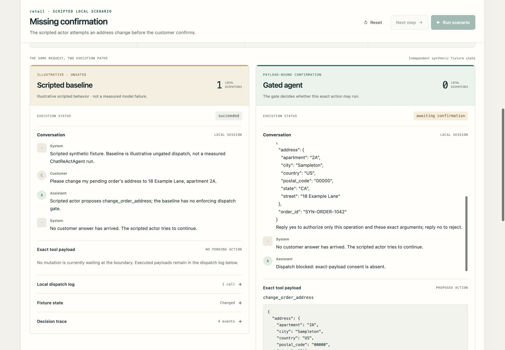

# Reliable Retail Agent

[](https://github.com/alexmunzon/reliable-retail-agent/actions/workflows/offline-tests.yml)

**A working safety boundary between an agent's proposed action and tool execution.** Fresh customer confirmation authorizes one exact payload; changes, stale consent, and uncertain outcomes are handled explicitly.

[Watch the 75-second demo](https://github.com/alexmunzon/reliable-retail-agent/releases/download/v0.5.2/reliable-retail-agent-demo.mp4) · [Download the release](https://github.com/alexmunzon/reliable-retail-agent/releases/tag/v0.5.2) · [Read the walkthrough](docs/CALL_WALKTHROUGH.md)



[Release readiness and deployment boundary](docs/RELEASE_READINESS.md): the integrated release is merged. The [restore completion](docs/RESTORE_COMPLETION.md) adds explicit recovery evidence, generation-aware replay and verified interrupted/repeated browser flows. An existing authorized host with persistent storage still needs to be identified; the app remains local-only.

## The engineering contribution

The project turns a conversational confirmation requirement into executable state transitions at the dispatch boundary. It includes:

- **Exact-action authorization:** typed mutation intents, canonical payload hashes, gate-owned complete prompts, fresh assent, and invalidation when material details change.
- **Controlled execution:** an explicit mutating-tool registry, one dispatch per local operation, refusal/ambiguity branches, and a stop on uncertain outcomes without automatic retry.
- **Observable behavior:** independent baseline/gated fixtures, actual local function calls, before/after state, prompt identity, and readable event traces in a responsive web UI.
- **Reproducible verification:** offline demo/metrics and harness tests, eight original-author integration tests, offline CI, source hashes, and an independent provenance/scoring review.
- **Durable local serving:** authenticated commands, a transactional SQLite claim/outbox, resumable SSE and a separate synthetic provider effect ledger. See [the serving runbook](docs/SERVING.md).
- **Read-only trace review:** the [dashboard](docs/observability/README.md) supports frozen fixtures and an authenticated local serving adapter, with explicit measurement and billing gaps.
- **Regression gate:** `python3 -m evalgate check` re-runs 75 scripted safety/usefulness cases (68 gating) against the pinned approved baseline and fails on any unauthorized dispatch, duplicate or wrong-payload effect, blocked legitimate action, incomplete or misleading consent prompt, or invalid evidence. See [the evaluation gate](docs/EVALUATION_GATE.md).

The implementation was developed with AI assistance. Original τ-bench code and published trajectories are attributed separately; the custom gate, interface, adapters, and verification are the project's additions. The design uses one actor with an enforcing gate, not multiple runtime agents.

## Run in one command

Python 3.11+ is sufficient for the demo. No API key, package installation, or cloud account is needed.

```bash
python3 scripts/start.py
```

Open **http://127.0.0.1:8765**. Stop with Ctrl+C and use the same command to restart. For another port, use `python3 scripts/start.py --port 8766`. The server must remain running; its synthetic sessions are in memory and reset on restart. Browser reload restores the active session while that server is alive.

## A two-minute walkthrough

1. Run **Missing confirmation**. The illustrative baseline dispatches once; the gate stays closed and its fixture remains unchanged.
2. Review the complete prompt, operation, payload, and SHA-256. Give a fresh **Yes, confirm**: exactly one local dispatch occurs.
3. Run **Changed payload**. The new apartment number requires new consent; the old approval cannot carry over.
4. Run **Uncertain tool outcome**. One attempt is recorded and further execution stops. Try **Airline domain transfer** to see the same boundary in another synthetic domain.

Eight scenarios also cover normal confirmation, stale consent, rejection, and ambiguity. Expand each lane's dispatch log, fixture state, and decision trace. The [captioned video](docs/video/README.md) records these real UI interactions.

## What the evidence establishes

| Evidence | Supports | Does not establish |
| --- | --- | --- |
| Scripted demo and automated tests | Specified state-machine, API, idempotency, and UI behavior | Measured model failures or improvements |
| Original FC/ReAct/Act offline checks | Unchanged author parser, environment, scorer, and trace plumbing on synthetic fixtures | A fresh benchmark run |
| 1,980 later author trajectories | Exact retrospective metrics for the pinned released records | Original paper Table 2 reproduction or current leaderboard comparability |

**Current gate `current-dev-v5` remains unevaluated against real models.** All demo scenarios are scripted and synthetic; the baseline is an illustration, not a measured ReAct failure. No real customer accounts, purchases, refunds, or passengers are used.

The original demo's attempt guard is scoped to its in-memory session. The separate [serving pilot](docs/SERVING.md) adds authentication, SQLite persistence, crash recovery and evidence-based reconciliation for one service process on local disk. Request idempotency, local claim deduplication and provider effect deduplication are distinct guarantees; distributed exactly-once execution and production policy completeness are not claimed. Unknown effects retain a related-resource hold and are never automatically redispatched. Native benchmark `Env.step` and reward calculation remain unchanged; scoring replay is excluded from actor traces. [Integration evidence and limitations](docs/INTEGRATION.md) distinguish implementation from verified results.

## Research evidence

- [Zero-cost author-artifact analysis](docs/ZERO_COST_REPRODUCTION.md): recomputes **1,980 later official author trajectories**, with complete task/trial grids, exact `pass^k` and distinct `pass@k`, and pinned source hashes.
- [Full-paper experiment audit](docs/FULL_REPRODUCTION_AUDIT.md): maps the paper's model comparison, method comparison, policy ablation, reliability, failure analysis, and task difficulty experiments.
- [Offline implementation runbook](docs/FULL_REPRODUCTION_RUNBOOK.md): verifies original author agent/environment/scorer code with explicit synthetic completion fixtures and no network calls.
- [Call walkthrough](docs/CALL_WALKTHROUGH.md) and [publication notes](docs/PUBLICATION.md).

**This is not a full historical paper reproduction.** The pinned paper-era source has no original released run logs; exact trial counts and some historical model snapshots are unspecified or unavailable. The four later author files were introduced in November 2024 and are not the original paper's Table 2 evidence. No fresh provider benchmark was run for this release. The upstream repository warns that these original tasks are outdated; no current leaderboard comparability is claimed.

The original study is [Yao et al., τ-bench (2024)](https://arxiv.org/abs/2406.12045). Official source: [sierra-research/tau-bench](https://github.com/sierra-research/tau-bench). Paper-era code: `6f4b718037db619539b8b692060e6686f3f0dcc9`. Requested later reference: `59a200c6d575d595120f1cb70fea53cef0632f6b`. See [third-party notices](THIRD_PARTY_NOTICES.md).

## Verify and extend

```bash
python3 scripts/ci.py
python3 -m reproduction.metrics --repo-root . --output /tmp/zero-cost-results.json
```

For the optional original-author checks, install `requirements-offline.txt` in a virtual environment and run `python3 scripts/ci.py --native`. See the [offline runbook](docs/FULL_REPRODUCTION_RUNBOOK.md) for exact setup.

[GitHub Actions](https://github.com/alexmunzon/reliable-retail-agent/actions) defines bounded offline, evaluation and backend jobs with read-only permissions, no model secrets, and no cache/artifact uploads. Hosted execution and required-check enforcement are separate evidence claims; see [current integration status](docs/INTEGRATION.md). Test workers drop inherited credentials and block outbound Python TCP connections. [CI details](docs/CI.md), [verification receipt](evidence/VERIFICATION.json), [browser evidence](evidence/BROWSER_WALKTHROUGH.md), and [independent review](evidence/ZERO_COST_INDEPENDENT_REVIEW.md) make the scope inspectable.

The remaining validation boundaries include missing history after stale restore, broader consent-language coverage and a separately authorized prospective real-model evaluation. Local deterministic tests and measured synthetic workloads do not establish production reliability or model improvement.

The deferred [post-build reflection](docs/POST_BUILD_REFLECTION.md) preserves the provider recovery, receipt-integrity and dashboard review. The subsequent [completion report](docs/RESTORE_COMPLETION.md) covers stale-restore evidence and client continuity, with before/after failures and full-flow verification.

## Development and continuity

Read [AGENTS.md](AGENTS.md), the shared instructions retained in [CLAUDE.md](CLAUDE.md), and [project state](docs/PROJECT_STATE.md) before editing. One user-facing ChatGPT/Astra session owns all three tracks, with scoped internal workers and bounded review loops. Preserved handoffs provide continuity; original conversation history was not migrated. These documents retain the architecture, authorization boundaries and unresolved holds.
