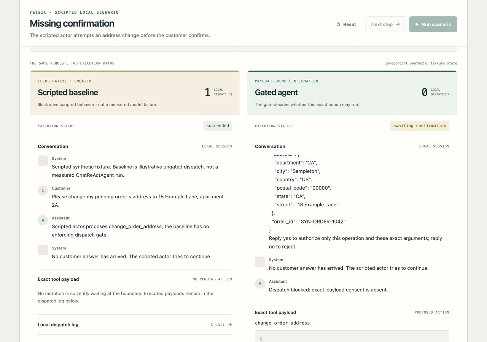

# 75-second live demo walkthrough

[Download/watch MP4](https://github.com/alexmunzon/reliable-retail-agent/releases/download/v0.5.2/reliable-retail-agent-demo.mp4) · [Caption transcript](demo.srt) · [Capture manifest](capture-manifest.json)

The video records real interactions with the running local app: missing consent, a complete confirmation prompt, fresh assent with repeated clicks, changed payload, uncertain mutation, airline transfer, and the separate research evidence page. These are scripted/synthetic scenarios executing local code, not model inference or benchmark performance.

Only the project's browser viewport was captured. The recording consists of five sequential 15-second segments, sampled at four actual viewport captures per second. Setup gaps between segments are omitted; outcome states are not altered. The 300 captures were encoded into a 75-second H.264 MP4 at 24 playback frames per second, with explanatory captions below the unchanged viewport. No unrelated desktop content, synthetic UI footage, paid narration, or provider calls were used.

The current gate remains unevaluated. The original paper's historical results have not been fully reproduced; the displayed author-artifact results come from a later official release.
